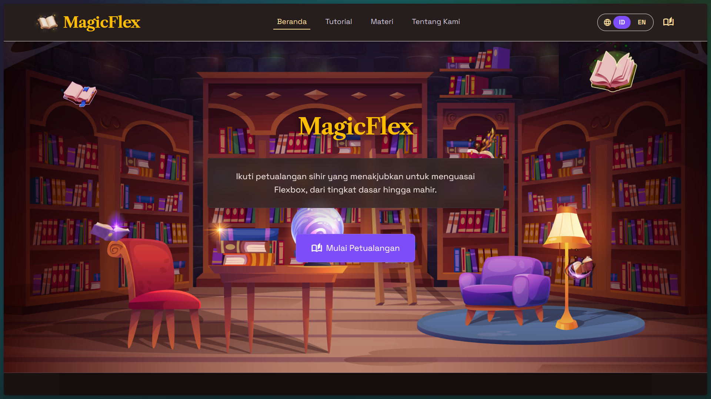
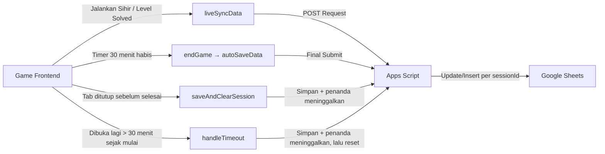

# MagicFlex - Interactive CSS Flexbox Learning Game

<div align="center">



**Belajar CSS Flexbox dengan Cara yang Menyenangkan!**

*Game edukasi interaktif berbasis web untuk mempelajari CSS Flexbox melalui 25 misi progresif.*

[](https://developer.mozilla.org/en-US/docs/Web/HTML)
[](https://developer.mozilla.org/en-US/docs/Web/CSS)
[](https://developer.mozilla.org/en-US/docs/Web/JavaScript)
[](https://jquery.com/)
[](https://tailwindcss.com/)
[](https://vercel.com/)
[](https://groq.com/)

[🎮 Demo](https://magicflex.my.id/) | [📚 Dokumentasi](#level-dan-materi) | [🚀 Instalasi](#instalasi) | [👥 Tim](#tim-pengembang)

</div>

---

## 📖 Daftar Isi

- [Tentang Proyek](#tentang-proyek)
- [Fitur Utama](#fitur-utama)
- [Tech Stack](#tech-stack)
- [Struktur File](#struktur-file)
- [Instalasi](#instalasi)
- [Cara Bermain](#cara-bermain)
- [Sistem Scoring](#sistem-scoring)
- [Integrasi Google Sheets](#integrasi-google-sheets)
- [AI Feedback (Groq)](#ai-feedback-groq)
- [Level & Materi](#level-dan-materi)
- [Konfigurasi](#konfigurasi)
- [Troubleshooting](#troubleshooting)
- [Tim Pengembang](#tim-pengembang)
- [Lisensi](#lisensi)

---
<a id="tentang-proyek"></a>
## 🎯 Tentang Proyek

**MagicFlex** adalah platform pembelajaran CSS Flexbox yang interaktif dan gamified. Siswa belajar dengan menyelesaikan 25 misi progresif, mendapat umpan balik secara langsung, progres tercatat otomatis ke Google Sheets, dan menerima saran belajar berbasis AI (Groq) di akhir permainan.

### 🌟 Keunggulan

- ✨ **Game-based Learning** - Belajar sambil bermain dengan misi menarik
- 🎨 **Visual Feedback** - Lihat hasil kode CSS secara langsung
- 📊 **Tracking Otomatis** - Data kemajuan tersimpan di Google Sheets
- 🤖 **AI Learning Advice** - Saran materi yang perlu dipelajari, dibuat oleh AI (Groq) berdasarkan hasil siswa
- ⏱️ **Timer System** - Batas waktu pengerjaan 30 menit
- 🌐 **Multilingual** - Antarmuka mendukung Bahasa Indonesia & English
- 📱 **Responsive Design** - Optimal di desktop dan mobile

---
<a id="fitur-utama"></a>
## 🚀 Fitur Utama

### 1. **Core Gameplay**
- 25 level progresif mengajarkan properti Flexbox
- Live code editor dengan validasi sintaks
- Visual rendering langsung dari kode CSS
- Progress tracking dengan indikator visual
- Auto-save progres ke localStorage
- Navigasi level: Previous/Next + direct jump ke level yang sudah dibuka

### 2. **Sistem Timer**
- Countdown **30 menit** per sesi permainan
- Tampilan ganda (desktop & mobile), format `MM:SS`
- Waktu mulai disimpan di localStorage sehingga tetap akurat saat halaman di-refresh
- Saat waktu habis, game berakhir otomatis dan hasil dikirim ke spreadsheet

### 3. **Integrasi Google Sheets**
- **Live Sync**: Data dikirim otomatis selama gameplay
- **Auto-save**: Update saat level dikerjakan atau diselesaikan
- **Penanda Meninggalkan Permainan**: Siswa yang menutup halaman sebelum selesai tetap tercatat, dengan penanda khusus
- **Session ID**: Satu sesi permainan = satu baris di spreadsheet

### 4. **AI Feedback (Groq)**
- Saran pembelajaran dibuat otomatis saat popup hasil kuis terbuka
- Berisi materi Flexbox yang perlu dipelajari, berdasarkan soal yang sulit atau belum selesai
- Siswa yang sudah mahir (25 soal selesai, tiap soal 1-2 percobaan) mendapat ucapan selamat dan **Langkah Belajar Selanjutnya**, tanpa memanggil AI
- Kalimat pembuka dan daftar properti yang dikuasai dibuat oleh kode, jawaban AI divalidasi, sehingga isinya selalu sinkron dengan data siswa
- Dijalankan lewat Vercel Serverless Function (`/api/groq`), API key tidak pernah dikirim ke browser
- Fallback otomatis antar model Groq dan cache hasil 24 jam
- Pesan error yang jelas jika API gagal

### 5. **Analisis Error**
- Parser CSS deteksi syntax error (titik dua / titik koma hilang)
- Deteksi typo nilai dan nama properti dengan algoritma Levenshtein
- Validasi properti Flexbox yang tidak diperlukan atau tidak dikenali
- Error modal dengan pesan dan petunjuk

### 6. **Progress Indicators**
- Visual dots grid untuk 25 level
- Status: Solved ✅, Current 🎯, Locked 🔒
- Klik navigasi ke level yang sudah dibuka

### 7. **Landing Page**
- Beranda, video tutorial (YouTube), materi interaktif per properti Flexbox, dan bagian Tentang Kami
- Handout PDF untuk diunduh (`images/Handout Magicflex Flexbox CSS.pdf`)
- Pemilih bahasa (ID/EN) yang diteruskan ke halaman game

### 8. **Fitur Tambahan**
- WhatsApp sharing skor akhir
- Reset game dengan konfirmasi
- View Transitions API untuk animasi smooth
- Interactive CSS tooltips dengan contoh

---
<a id="tech-stack"></a>
## 🛠️ Tech Stack

### Frontend
- **HTML5** - Struktur semantik
- **CSS3** - Styling & animasi custom
- **Tailwind CSS** (CDN) - Utility-first framework
- **jQuery 3.6.0** - DOM manipulation & event handling
- **SweetAlert2 v11** - Modal & popup

### Fonts & Icons
- **Google Fonts**: Space Grotesk, Libre Caslon Text
- **Material Symbols Outlined** - Icon library

### Backend & Integrasi
- **Vercel** - Hosting statis + Serverless Functions (Node.js 24.x)
- **Groq API** - AI feedback (`openai/gpt-oss-20b`, fallback `openai/gpt-oss-120b`)
- **Google Apps Script** - Backend penyimpanan ke spreadsheet
- **Google Sheets** - Pencatatan progres siswa

---
<a id="struktur-file"></a>
## 📁 Struktur File

```
magicflex_2/
├── index.html                 # Landing page (beranda, tutorial, materi, tentang kami)
├── game.html                  # Interface game utama
├── favicon.ico
├── google-apps-script.js      # Backend Apps Script untuk Google Sheets
├── package.json               # Metadata project & script Vercel
├── vercel.json                # Rewrites (/game) & security headers
├── robots.txt / sitemap.xml   # SEO
├── .env.example               # Contoh environment variable (GROQ_API_KEY)
├── SWEETALERT_FIX.md          # Dokumentasi fix SweetAlert2
├── README.md                  # Dokumentasi proyek (file ini)
│
├── api/
│   ├── groq.js               # Serverless function AI feedback (DIPAKAI game)
│   └── gemini.js             # Sisa versi lama, tidak dipanggil oleh game
│
├── css/
│   ├── style.css             # Main game styles (1595 baris)
│   └── custom.css            # Animasi & efek kustom (85 baris)
│
├── js/
│   ├── game.js               # Core game logic: timer, validasi, sync, hasil (2138 baris)
│   ├── levels.js             # 25 definisi level (280 baris)
│   ├── translations.js       # Teks UI ID/EN & prompt AI (403 baris)
│   ├── messages.js           # Teks tambahan (29 baris)
│   ├── docs.js               # Dokumentasi CSS tooltips (34 baris)
│   ├── config.js             # Loader konfigurasi browser, tanpa API key (72 baris)
│   ├── dashboard-translations.js  # Terjemahan landing page (80 baris)
│   └── tailwind-config.js    # Konfigurasi tema Tailwind (135 baris)
│
└── images/
    ├── bg.png, tumbnail.png, logo.svg   # Background, banner, logo
    ├── Bola*.svg             # Magic ball elements (Air, Api, Tanah)
    ├── portal*.png           # Portal target elements
    ├── element *.svg         # Elemen dekoratif (1-5)
    ├── ima/icha/anike/candra.jpg   # Foto tim
    └── Handout *.pdf         # Materi pembelajaran
```

---

<a id="instalasi"></a>
## 💻 Instalasi

### Prasyarat
- Web browser modern (Chrome, Firefox, Edge, Safari)
- Node.js 24.x dan [Vercel CLI](https://vercel.com/docs/cli) (`npm i -g vercel`)
- Akun Groq dan API key dari [console.groq.com/keys](https://console.groq.com/keys)
- Google Account untuk setup Sheets (opsional)

### Setup Lokal

1. **Clone repository**
   ```bash
   git clone https://github.com/username/magicflex.git
   cd magicflex
   ```

2. **Siapkan environment variable**
   ```bash
   cp .env.example .env
   ```
   Lalu isi `.env`:
   ```
   GROQ_API_KEY=isi_api_key_groq_anda
   ```
   > File `.env` sudah ada di `.gitignore`. Jangan pernah meng-commit API key.

3. **Jalankan dengan Vercel Dev**
   ```bash
   npm run dev
   ```

4. **Akses di browser**
   ```
   http://localhost:3000
   ```

> ⚠️ Server statis biasa (`python -m http.server`, `live-server`) tetap bisa menjalankan game, tetapi endpoint `/api/groq` tidak tersedia sehingga **saran AI tidak akan muncul**. Gunakan `vercel dev` untuk menguji fitur AI.

### Deploy ke Vercel

1. Import repository ke Vercel (atau jalankan `npm run deploy`)
2. Buka **Project Settings > Environment Variables**
3. Tambahkan `GROQ_API_KEY` dengan API key Groq Anda
4. Redeploy agar variable terbaca

### Setup Google Sheets Integration

1. **Buat Google Spreadsheet baru**

2. **Isi header di baris 1** (script tidak membuat header otomatis):
   ```
   A: Timestamp | B: Nama | C: No Absen | D: Skor | E: Waktu Pengerjaan
   F-AD: Q1 ... Q25 (satu kolom per soal)
   AE: Session ID (kolom internal, boleh disembunyikan)
   ```

3. **Setup Apps Script**
   - Buka Extensions > Apps Script
   - Copy isi file `google-apps-script.js`
   - Paste ke editor Apps Script
   - Save project

4. **Deploy sebagai Web App**
   - Klik Deploy > New deployment
   - Type: Web app
   - Execute as: Me
   - Who has access: Anyone
   - Copy Web App URL

5. **Update URL di game.js**
   ```javascript
   // js/game.js, properti googleScriptUrl (sekitar baris 36)
   googleScriptUrl: "PASTE_WEB_APP_URL_DISINI"
   ```

> 🔄 Setiap kali `google-apps-script.js` diubah (misalnya durasi timer), salin ulang ke editor Apps Script lalu buat deployment versi baru (**Deploy > Manage deployments > Edit > New version**). Jika tidak, spreadsheet masih memakai kode lama.

---
<a id="cara-bermain"></a>
## 🎮 Cara Bermain

### Alur Permainan

1. **🚀 Start Game**
   - Buka `game.html` (atau klik **Mulai Petualangan** di landing page)
   - Masukkan Nama & No Absen
   - Timer **30 menit** dimulai

2. **📝 Solve Levels**
   - Baca instruksi di panel kiri
   - Tulis kode CSS di editor "Editor Buku Sihir"
   - Klik **Jalankan Sihir** untuk menguji kode
   - Lihat hasil visual di panel kanan

3. **✅ Validasi**
   - Jika benar: bola mencapai portal ✨ dan lanjut ke soal berikutnya
   - Jika salah: error analysis muncul ❌
   - Soal harus diselesaikan terlebih dahulu sebelum pindah ke soal lain

4. **🏆 Finish**
   - Selesaikan 25 level atau tunggu waktu habis
   - Lihat hasil akhir dan saran belajar dari AI
   - Share ke WhatsApp (opsional)

### Tombol & Kontrol

| Tombol | Fungsi |
|--------|--------|
| **Jalankan Sihir** | Menguji kode CSS (dihitung sebagai 1 percobaan) |
| **‹ ›** | Navigasi Previous/Next level (lanjut hanya jika soal saat ini sudah benar) |
| **Atur Ulang** | Menghapus kode di soal yang sedang dikerjakan (dengan konfirmasi) |
| **Mulai Permainan Baru** | Mulai ulang dari level 1 (dengan konfirmasi) |
| **Progress Dots** | Klik untuk pindah ke level yang sudah dibuka |
| **ID / EN** | Ganti bahasa antarmuka |

### Tips Bermain

💡 **Gunakan tooltip**: Klik kata `code` di instruksi untuk melihat dokumentasi CSS  
💡 **Test berkala**: Klik Jalankan Sihir untuk melihat efek setiap perubahan  
💡 **Baca error**: Error analysis memberikan petunjuk spesifik  
💡 **Kelola waktu**: Kamu punya 30 menit untuk 25 soal, jangan terlalu lama di satu soal  
💡 **Jangan tutup halaman**: Jika ditutup sebelum selesai, hasilmu tercatat dengan penanda meninggalkan permainan  

---
<a id="sistem-scoring"></a>
## 📊 Sistem Scoring

### Perhitungan Skor

```javascript
Score = Math.round((Jumlah Level Solved / 25) × 100)
```

### Data yang Dicatat

**Per Siswa:**
- Nama
- No Absen (nomor numerik dinormalkan: `01`, `001`, dan `1` dianggap sama)
- Skor akhir (%)
- Waktu pengerjaan (maksimal 30 menit)
- Timestamp submission terakhir

**Per Level (Q1-Q25):**
- **Percobaan**: Jumlah klik **Jalankan Sihir** (ditambah percobaan saat pindah level jika kode berubah)
- **Status**: Selesai atau Belum Selesai

### Performance Level

| Skor | Badge | Warna |
|------|-------|-------|
| ≥ 90% | 🌟 Luar Biasa! | Hijau |
| 80-89% | 🎯 Sangat Baik! | Biru |
| 70-79% | 👍 Baik! | Ungu |
| 60-69% | 📈 Cukup Baik! | Orange |
| < 60% | 💪 Tetap Semangat! | Merah |

---
<a id="integrasi-google-sheets"></a>
## 🔗 Integrasi Google Sheets

### Alur Data



### Fungsi Backend (Apps Script)

#### **doPost(e)**
Menerima POST request dari frontend:

**Parameter:** `nama`, `absen`, `skor`, `waktuPengerjaan`, `detailJawaban` (JSON), `sessionId`

**Validasi:**
- Nama & No Absen wajib diisi
- Proteksi bug: data **ditolak** jika waktu pengerjaan > 30 menit
- `action=delete` tidak lagi menghapus apa pun (hanya dibalas sukses untuk kompatibilitas)

**Cara kerja baris:**
- Baris dicari berdasarkan `sessionId` (kolom AE). Jika ada, baris diperbarui. Jika tidak, baris baru dibuat.
- Kolom Waktu Pengerjaan berwarna merah jika mengandung penanda "siswa meninggalkan permainan"

### Business Rules

| Skenario | Data di Spreadsheet |
|----------|---------------------|
| Timer habis (30:00 → 0:00) saat siswa aktif | ✅ **TERSIMPAN** tanpa penanda |
| Semua 25 level selesai | ✅ **TERSIMPAN** tanpa penanda |
| Siswa menutup/meninggalkan halaman sebelum selesai | ✅ **TERSIMPAN** dengan penanda *(siswa meninggalkan permainan)* |
| Siswa membuka lagi setelah > 30 menit sejak mulai | ✅ **TERSIMPAN** dengan penanda, lalu game direset |
| Bug sistem mengirim waktu > 30 menit | ❌ **DITOLAK** (proteksi) |

### Format Spreadsheet

```
| Timestamp        | Nama    | No Absen | Skor | Waktu Pengerjaan   | Q1                          | Q2                          | ... | Q25 |
|------------------|---------|----------|------|--------------------|-----------------------------|-----------------------------|-----|-----|
| 9/14/2026 08:30  | Chandra | 1        | 92   | 28 menit 15 detik  | 2 kali percobaan (Selesai)  | 1 kali percobaan (Selesai)  | ... | -   |
```

- Soal yang belum dicoba ditulis `-`
- Waktu ditulis mengikuti bahasa yang dipakai siswa (`28 menit 15 detik` atau `28 minute(s) 15 second(s)`)

**Warna Cell:**
- 🟢 Hijau (#d9ead3): Soal selesai
- 🔴 Merah (#f4cccc): Sudah dicoba tetapi belum selesai
- ⚪ Putih (#ffffff): Belum dikerjakan

---
<a id="ai-feedback-groq"></a>
## 🤖 AI Feedback (Groq)

Komponen ini dibuat otomatis ketika popup hasil kuis terbuka. Isinya bergantung pada hasil siswa:

| Kondisi siswa | Yang ditampilkan | Memanggil AI? |
|---------------|------------------|---------------|
| 25 soal selesai, tiap soal selesai dalam 1-2 percobaan | **Langkah Belajar Selanjutnya**: ucapan selamat, total dan rata-rata percobaan, lalu 3 langkah lanjut (`flex-grow`/`flex-shrink`/`flex-basis`, CSS Grid, layout responsif) | Tidak |
| Ada materi yang perlu diulang atau belum dikerjakan | **Saran Pembelajaran AI**: pembuka dari kode + materi dari AI | Ya |
| Belum selesai, tetapi soal tersisa hanya memakai properti yang sudah dikuasai | Pembuka + ajakan menyelesaikan soal tersisa | Tidak |

Batas "lancar" memakai konstanta `HARD_TRIES = 3` di `js/translations.js`: soal yang selesai dengan 3 percobaan atau lebih dianggap perlu diulang.

**Alur saran AI:**

1. `summarizeQuizForAI()` (`js/translations.js`) merangkum hasil siswa: soal sulit, soal belum dicoba, properti yang sudah dikuasai, dan properti yang perlu dipelajari. Dua daftar terakhir tidak pernah beririsan
2. Kalimat pembuka (jumlah soal selesai dan properti yang dikuasai) dibuat oleh kode, bukan AI
3. Prompt (Bahasa Indonesia atau English, sesuai bahasa aktif) dikirim ke `POST /api/groq`. AI hanya menulis butir materi dan ringkasan
4. Serverless function memanggil Groq Chat Completions dengan model `openai/gpt-oss-20b`. Jika gagal, otomatis mencoba `openai/gpt-oss-120b`
5. `sanitizeAIBody()` memvalidasi jawaban AI: butir untuk properti di luar daftar dibuang, materi yang tidak dibahas diisi dari `FLEX_NOTES`, dan ringkasan yang menyebut properti di luar daftar atau mengklaim penguasaan diganti kalimat tetap
6. Hasil disimpan di localStorage selama 24 jam (kunci `ai_feedback_v4_...` berdasarkan session ID, skor, dan jumlah benar)

**Karakteristik respons:** gaya bahan ajar formal, tanpa code block, maksimal sekitar 150 kata.

**Environment variable:**

| Nama | Keterangan |
|------|------------|
| `GROQ_API_KEY` | API key Groq. Wajib di `.env` (lokal) atau Environment Variables Vercel (produksi) |

> `js/config.js` sengaja tidak memuat API key. Semua pemanggilan AI lewat server.

---

<a id="level-dan-materi"></a>
## 📚 Level & Materi

### 25 Level Progresif

#### **Levels 1-4: `justify-content`**
Konsep: Perataan horizontal (main axis)
- Level 1: `flex-end`
- Level 2: `center`
- Level 3: `space-around`
- Level 4: `space-between`

#### **Levels 5-7: `align-items`**
Konsep: Perataan vertikal (cross axis)
- Level 5: `flex-end`
- Level 6-7: Kombinasi dengan `justify-content`

#### **Levels 8-13: `flex-direction`**
Konsep: Arah sumbu utama dan perubahan perilaku axis
- Level 8: `row-reverse`
- Level 9: `column`
- Level 10-13: Kombinasi dengan `justify-content` dan `align-items` (termasuk `column-reverse`)

#### **Levels 14-17: `order` & `align-self`**
Konsep: Manipulasi individual item
- Level 14-15: `order`
- Level 16: `align-self`
- Level 17: `align-self` dikombinasikan dengan `order`

#### **Levels 18-20: `flex-wrap` & `flex-flow`**
Konsep: Multi-line layouts
- Level 18: `wrap`
- Level 19: `column` + `wrap`
- Level 20: `flex-flow` shorthand

#### **Levels 21-24: `align-content`**
Konsep: Spacing untuk multi-line
- Level 21-22: `flex-start` dan `flex-end`
- Level 23-24: Kombinasi kompleks dengan `column-reverse` dan `wrap-reverse`

#### **Level 25: Final Exam**
Konsep: Challenge gabungan semua properti (`flex-direction`, `flex-wrap`, `align-content`, `justify-content`, `align-items`)

### Dokumentasi CSS (docs.js)

Tooltips interaktif untuk:
- `align-content`
- `align-items`
- `align-self`
- `flex-direction`
- `flex-flow`
- `flex-wrap`
- `justify-content`
- `order`

**Cara Akses**: Klik `<code>` element di instruksi level

---
<a id="konfigurasi"></a>
## ⚙️ Konfigurasi

### Durasi Timer

Batas waktu diatur lewat konstanta `GAME_DURATION_SECONDS`. Nilainya harus **sama di dua tempat**:

```javascript
// js/game.js (baris 28)
var GAME_DURATION_SECONDS = 30 * 60; // 30 menit

// google-apps-script.js (baris 15)
var GAME_DURATION_SECONDS = 30 * 60; // 30 menit
```

Jika mengubah durasi, ubah juga:
- Tampilan awal timer di `game.html` (`id="timer"` dan `id="timer-mobile"`, saat ini `30:00`)
- Teks `timeoutText` dan `timeoutFallback` di `js/translations.js`
- Lalu deploy ulang Apps Script (lihat catatan di bagian Google Sheets)

### Tailwind Theme (js/tailwind-config.js)

**Material Design 3 Color Tokens:**
```javascript
colors: {
  primary: '#7D4EFA',
  secondary: '#7B61FF',
  tertiary: '#6366F1',
  surface: {
    dim: '#1a1c2e',
    bright: '#2d3250',
    container: {
      lowest: '#0f1117',
      low: '#181a25',
      DEFAULT: '#1f212e',
      high: '#2a2d3a',
      highest: '#343746'
    }
  },
  // ... dan lainnya
}
```

**Typography Scale:**
```javascript
fontFamily: {
  'body-md': ['Space Grotesk'],
  'headline-lg': ['Space Grotesk', 'bold'],
  'display': ['Libre Caslon Text']
}
```

### Multilingual (js/translations.js)

**Bahasa Tersedia:**
- English (`en`)
- Bahasa Indonesia (`id`)

**Cara Ganti Bahasa:**
- Klik tombol **ID / EN** di header, atau buka `game.html#en` / `game.html#id`
- Pilihan bahasa disimpan di localStorage (`language`)

**Note**: Instruksi tiap level (`js/levels.js`) saat ini hanya tersedia dalam Bahasa Indonesia

### Vercel (vercel.json)

- Rewrite `/` → `index.html` dan `/game` → `game.html`
- Security headers: `X-Content-Type-Options`, `X-Frame-Options: DENY`, `X-XSS-Protection`
- `robots.txt` memblokir crawler dari `/api/`

---

## 🐛 Troubleshooting

### SweetAlert2 Tidak Muncul

**Gejala**: Modal tidak muncul di GitHub Pages

**Solusi**: Sudah diterapkan di proyek (lihat `SWEETALERT_FIX.md`)
- CDN updated ke latest v11
- AlertHelper fallback system
- Extended wait logic (10s timeout)
- Try-catch wrappers semua `Swal.fire()`

### Saran AI Tidak Muncul / Error

**Checklist:**
1. ✅ `GROQ_API_KEY` sudah diisi di `.env` (lokal) atau Environment Variables Vercel (produksi)?
2. ✅ Dijalankan dengan `vercel dev` atau sudah di-deploy ke Vercel? (server statis biasa tidak punya `/api/groq`)
3. ✅ Setelah menambah environment variable di Vercel, sudah redeploy?
4. ✅ Cek **Vercel Function Logs** untuk pesan error dari Groq (misalnya limit atau model tidak tersedia)

### Data Tidak Tersimpan ke Spreadsheet

**Checklist:**
1. ✅ Apps Script sudah di-deploy sebagai Web App?
2. ✅ URL `googleScriptUrl` di `js/game.js` sudah benar?
3. ✅ Permission "Anyone" di deployment settings?
4. ✅ Apps Script sudah diperbarui ke versi terbaru (batas 30 menit)? Versi lama menolak data jika waktu > 60 detik
5. ✅ Cek browser console untuk error fetch

**Debug:**
```javascript
// Di browser console
localStorage.getItem("playerName")
localStorage.getItem("playerAbsence")
localStorage.getItem("sessionId")
```

### Timer Tidak Sesuai

**Penyebab Umum:**
- Sisa waktu (`timeLeft`) dan waktu mulai (`gameStartTime`) tersimpan di localStorage, jadi sesi lama bisa terbawa
- Jika halaman dibuka lagi lebih dari 30 menit sejak mulai, game otomatis direset dengan penanda meninggalkan permainan

**Solusi:**
```javascript
// Reset localStorage
localStorage.clear();
location.reload();
```

### Level Tidak Bisa Dibuka

**Penyebab**: Level sebelumnya belum diselesaikan

**Cek Status:**
```javascript
// Di browser console
game.solved // Array level yang sudah solved
game.level  // Current level (0-24)
```

---

<a id="tim-pengembang"></a>
## 👥 Tim Pengembang

<table>
  <tr>
    <td align="center">
      <br/>
      <b>Ima Umiatul Chusnah</b><br/>
    </td>
    <td align="center">
      <br/>
      <b>Hanydhar Rose Manicha</b><br/>
    </td>
    <td align="center">
      <br/>
      <b>Maridho Anike Putri</b><br/>
    </td>
    <td align="center">
      <br/>
      <b>Candra Febriyanto</b><br/>
    </td>
  </tr>
</table>

---
<a id="lisensi"></a>
## 📄 Lisensi

Project ini dibuat untuk tujuan edukasi.

---

## 🙏 Acknowledgments

- **SweetAlert2** - Beautiful modal library
- **jQuery** - DOM manipulation
- **Tailwind CSS** - Utility-first CSS framework
- **Google Fonts** - Space Grotesk & Libre Caslon Text
- **Material Design 3** - Color system inspiration
- **Flexbox Froggy** - Gameplay concept inspiration
- **Groq** - Inferensi AI untuk saran pembelajaran
- **Vercel** - Hosting & Serverless Functions

---

## 📞 Kontak

Untuk pertanyaan, saran, atau bug report, silakan buka [WhatsApp Developer](https://wa.me/+6287769006246).

---

<div align="center">

**Made with 💜 by MagicFlex Team**

⭐ Star project ini jika bermanfaat!

</div>
